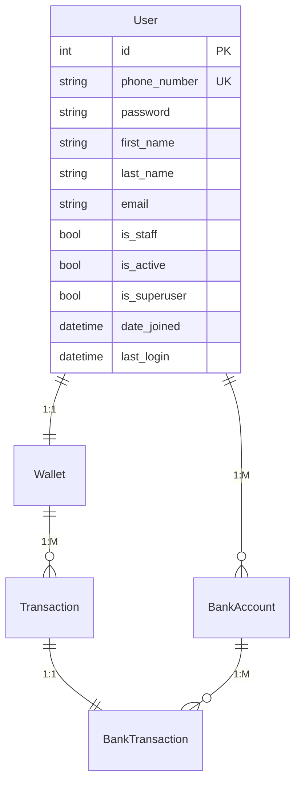

# Ledger

A backend financial ledger and transaction-processing platform built with **Django REST Framework**.

The system allows users to maintain a wallet, link multiple bank accounts, and record financial transactions. Bank-side transactions are processed through a payment-gateway service, while **PostgreSQL** provides persistence and **Redis + Celery** support asynchronous processing.

## Features

- User registration and authentication
- JWT-based authentication with access and refresh tokens
- One wallet per user
- Multiple bank accounts per user
- Wallet transaction management
- Bank transaction processing
- Transaction success and failure tracking
- Payment-gateway integration
- Asynchronous task processing with Celery
- Redis as the Celery message broker
- PostgreSQL database
- Django Admin interface
- Docker Compose for local infrastructure
- Database migrations
- Postman collection for API testing

---

## Tech Stack

| Component | Technology |
|---|---|
| Language | Python 3.12 |
| Web Framework | Django 6.1 |
| API | Django REST Framework |
| Authentication | JWT / Simple JWT |
| Database | PostgreSQL |
| Async Processing | Celery |
| Message Broker | Redis |
| Package Management | uv |
| Infrastructure | Docker / Docker Compose |
| API Testing | Postman |
| Payment Integration | Node.js payment-gateway service |

Django 6.1 supports Python 3.12 and later.

---

## Architecture

```text
                         ┌──────────────────┐
                         │      Client      │
                         │  Postman / API   │
                         └────────┬─────────┘
                                  │
                                  ▼
                    ┌─────────────────────────┐
                    │     Django REST API     │
                    │                         │
                    │  User / Wallet / Bank   │
                    │  Account / Transaction  │
                    └───────┬─────────┬───────┘
                            │         │
                            │         │
                            ▼         ▼
                    ┌────────────┐  ┌──────────────┐
                    │ PostgreSQL │  │    Redis     │
                    │            │  │              │
                    │ Persistent │  │ Celery Broker│
                    │   Data     │  │              │
                    └────────────┘  └──────┬───────┘
                                           │
                                           ▼
                                    ┌──────────────┐
                                    │    Celery    │
                                    │    Worker    │
                                    └──────┬───────┘
                                           │
                                           ▼
                              ┌────────────────────────┐
                              │   Payment Gateway      │
                              │    External Service    │
                              └────────────────────────┘
```

### Transaction flow

A typical bank transaction follows this general flow:

```text
API Request
    │
    ▼
Validate Request
    │
    ▼
Create / Update Transaction
    │
    ▼
Process Bank Transaction
    │
    ▼
Payment Gateway
    │
    ├── Success ──► Update transaction state
    │
    └── Failure ──► Record failure reason/state
```

---

## Data Model



| Entity | Description |
|---|---|
| **User** | Account holder |
| **Wallet** | One wallet associated with each user |
| **BankAccount** | Bank account linked to a user |
| **Transaction** | Ledger transaction associated with a wallet |
| **BankTransaction** | Bank-side transaction associated with a ledger transaction and bank account |

### Relationships

| Relationship | Cardinality |
|---|---|
| User → Wallet | 1 : 1 |
| User → BankAccount | 1 : M |
| Wallet → Transaction | 1 : M |
| Transaction → BankTransaction | 1 : 1 |
| BankAccount → BankTransaction | 1 : M |

---

## Project Structure

```text
ledger_project/
│
├── bank_account_app/
│   ├── migrations/
│   ├── models.py
│   ├── serializers.py
│   ├── views.py
│   └── ...
│
├── bank_txn_app/
│   ├── migrations/
│   ├── gateway.py
│   ├── models.py
│   ├── serializers.py
│   ├── tasks.py
│   ├── views.py
│   └── ...
│
├── txn_app/
│   ├── migrations/
│   ├── models.py
│   ├── serializers.py
│   ├── views.py
│   └── ...
│
├── user_app/
│   ├── migrations/
│   ├── authentication.py
│   ├── middleware.py
│   ├── models.py
│   ├── serializers.py
│   ├── views.py
│   └── ...
│
├── wallet_app/
│   ├── migrations/
│   ├── models.py
│   ├── serializers.py
│   ├── views.py
│   └── ...
│
├── config/
│   ├── celery.py
│   ├── settings.py
│   ├── urls.py
│   ├── asgi.py
│   └── wsgi.py
│
├── payment_gateway_node/
│   └── ...
│
├── Ledger_API.postman_collection.json
├── docker-compose.yml
├── pyproject.toml
├── uv.lock
├── .python-version
├── .env.example
├── .gitignore
└── README.md
```

---

## Prerequisites

Install the following before running the project:

- **Python 3.12+**
- **uv**
- **Docker Desktop** or Docker Engine with Docker Compose
- **Node.js** if running the payment-gateway service locally

Verify the installations:

```bash
python --version
uv --version
docker compose version
node --version
```

---

## Environment Configuration

The project uses environment variables for configuration.

Create a local `.env` file based on `.env.example`:

```bash
cp .env.example .env
```

On Windows PowerShell:

```powershell
Copy-Item .env.example .env
```

Example configuration:

```env
SECRET_KEY=your-django-secret-key
DEBUG=True

DB_NAME=ledgerdb
DB_USER=postgres
DB_PASSWORD=postgres
DB_HOST=localhost
DB_PORT=5432

PAYMENT_GATEWAY_BASE_URL=http://localhost:3000

CELERY_BROKER_URL=redis://localhost:6379/0
```

**Do not commit `.env` to Git.**

The repository contains `.env.example` only, with placeholder values.

---

## Installation

### 1. Install Python dependencies

From the project root:

```bash
uv sync
```

This creates the project's virtual environment and installs the dependencies defined in `pyproject.toml`.

---

## Start Infrastructure

### 2. Start PostgreSQL and Redis

```bash
docker compose up -d
```

Check the running containers:

```bash
docker compose ps
```

The development configuration uses:

| Service | Default |
|---|---|
| PostgreSQL database | `ledgerdb` |
| PostgreSQL user | `postgres` |
| PostgreSQL port | `5432` |
| Redis | `localhost:6379` |

These are local development defaults and should not be treated as production credentials.

---

## Database Setup

### 3. Apply migrations

```bash
uv run manage.py migrate
```

### 4. Create an admin user

Optional:

```bash
uv run manage.py createsuperuser
```

---

## Run Django

### 5. Start the development server

```bash
uv run manage.py runserver
```

The API will be available at:

```text
http://127.0.0.1:8000/
```

Django Admin:

```text
http://127.0.0.1:8000/admin/
```

API:

```text
http://127.0.0.1:8000/api/
```

---

## Run Celery

Start the Celery worker in a second terminal:

```bash
uv run celery -A config worker --loglevel=INFO -P=solo
```

The Celery worker uses Redis as its message broker.

Stop the worker with:

```text
Ctrl + C
```

---

## Payment Gateway

The Ledger integrates with a payment-gateway service through the `bank_txn_app` integration layer.

Configure the gateway URL using:

```env
PAYMENT_GATEWAY_BASE_URL=http://localhost:3000
```

The payment gateway is maintained as a separate service.

> **Note:** The payment-gateway service was provided as part of the project setup and is used by the Ledger application for payment processing. It is not presented as original implementation by the author.

If the gateway is included in the repository, start it according to the instructions provided in its own README.

---

## API Testing

A Postman collection is included in the repository:

```text
Ledger_API.postman_collection.json
```

Import the collection into Postman to test the available APIs.

The API includes functionality for areas such as:

- User management
- Authentication
- Wallets
- Bank accounts
- Transactions
- Bank transactions

---

## Common Commands

| Task | Command |
|---|---|
| Install dependencies | `uv sync` |
| Start Django | `uv run manage.py runserver` |
| Make migrations | `uv run manage.py makemigrations` |
| Apply migrations | `uv run manage.py migrate` |
| Create superuser | `uv run manage.py createsuperuser` |
| Django shell | `uv run manage.py shell` |
| Start Celery | `uv run celery -A config worker --loglevel=INFO -P=solo` |
| Start infrastructure | `docker compose up -d` |
| Stop infrastructure | `docker compose stop` |
| Stop and remove containers | `docker compose down` |
| Remove containers and volumes | `docker compose down -v` |

---

## Development Notes

### Database migrations

Django migration files are committed to the repository so that the database schema can be reproduced consistently across environments.

### Configuration

Sensitive configuration such as Django `SECRET_KEY`, database credentials, and environment-specific service URLs should be supplied through environment variables rather than committed to source control.

### Authentication

The API uses JWT authentication with configurable access and refresh token lifetimes.

---

## Future Improvements

Potential improvements include:

- Increase automated test coverage
- Add API documentation with OpenAPI/Swagger
- Add production deployment configuration
- Add structured application monitoring
- Add CI/CD pipeline
- Improve transaction idempotency and retry handling
- Add integration tests for the payment gateway
- Add containerization for the Django application and Celery worker

---

## License

This project is intended as a backend engineering/portfolio project.